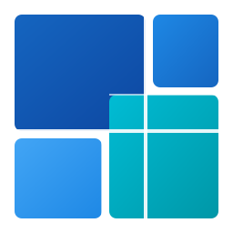
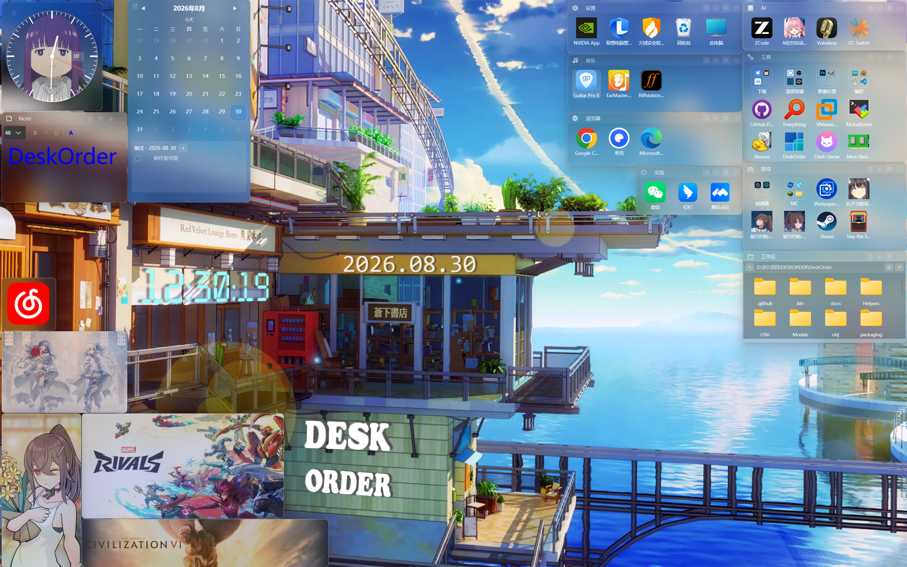
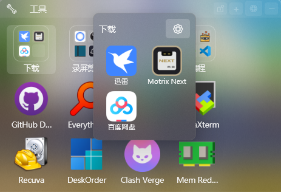
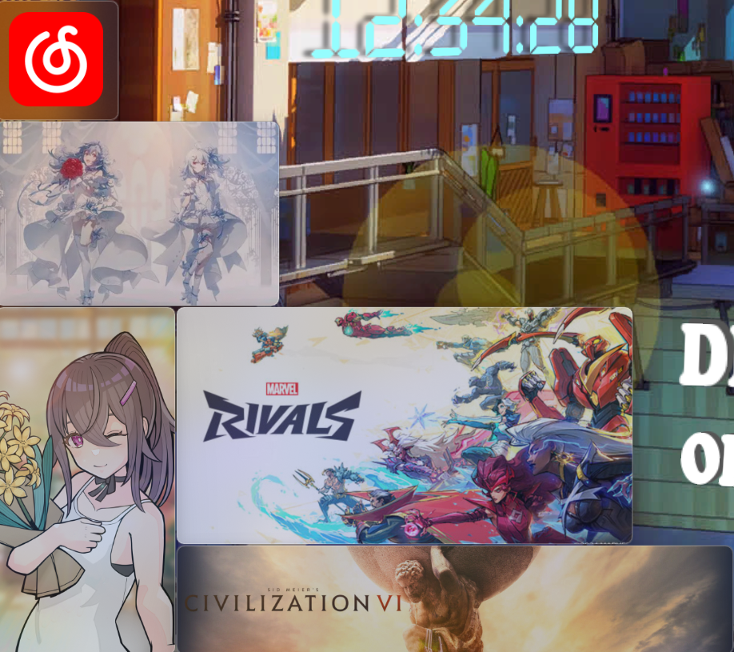
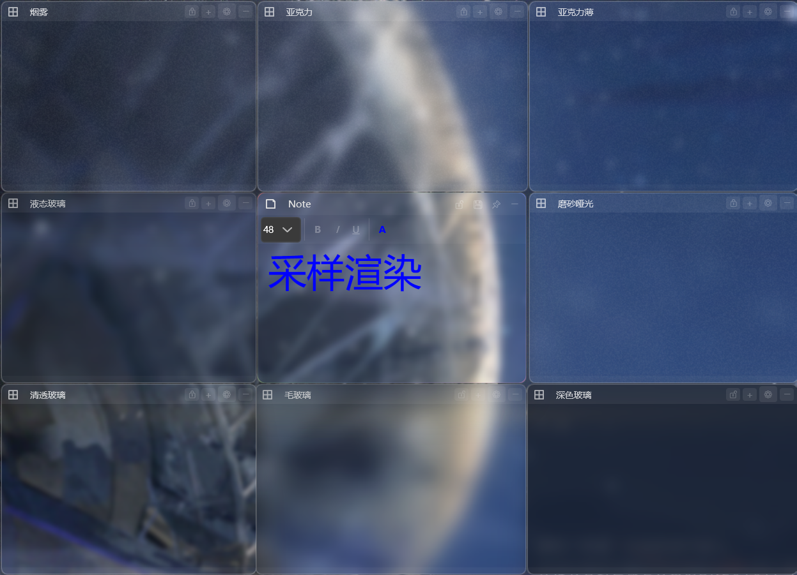
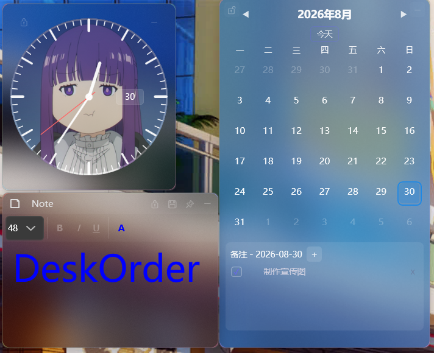
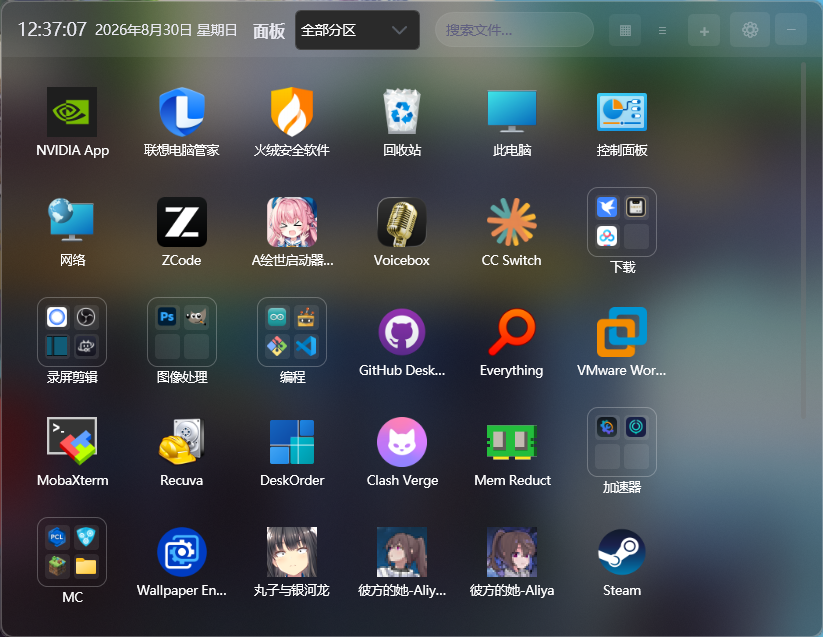
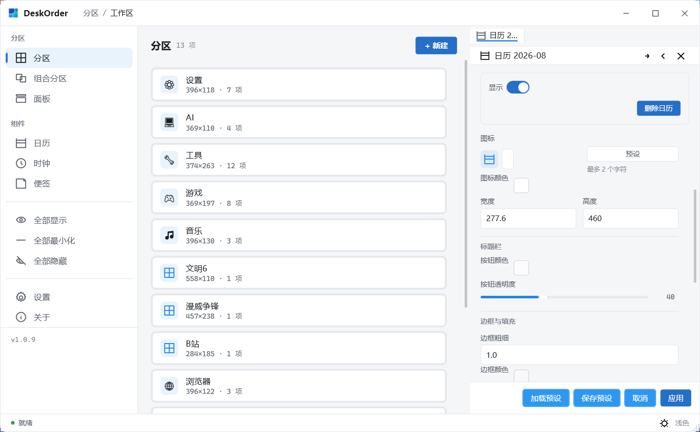
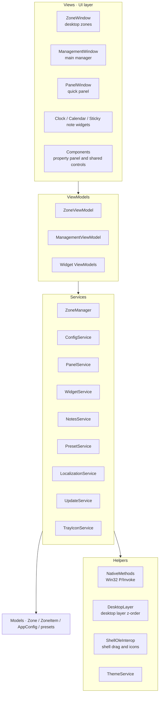

[简体中文](README.md) | **English**

<div align="center">
  

  <h1>DeskOrder</h1>

  <p><strong>Desktop organization and tile beautification, in one app</strong></p>

  <p>
    <a href="https://github.com/Three-Freezen/DeskOrder/releases/latest"></a>
    <a href="https://github.com/Three-Freezen/DeskOrder/releases"></a>
    <a href="LICENSE"></a>
    
    
    <a href="https://three-freezen.github.io/DeskOrder/"></a>
  </p>
</div>



---

## About

A messy desktop needs organizing; a plain desktop could look better. That used to mean two different tools. DeskOrder does both: zones keep your icons tidy, while tiles, liquid glass and widgets make the desktop look the way you want.

- Desktop organization and tile beautification in one app
- Every style is tunable — save it as a preset card and apply it anywhere with one click
- Icons are just references to the original file paths — files never move, and deleting an icon never touches the file

## Screenshots













## Download & Install

Requirements: Windows 10 1809 (build 17763) or later, 64-bit. The app ships with its own runtime — no .NET installation needed.

Two packages are available:

- **Installer** DeskOrder-win-Setup.exe: setup wizard, with in-app upgrades afterwards
- **Portable** DeskOrder-win-Portable.zip: unzip and run

Command-line download (PowerShell, always fetches the latest release):

```powershell
# Installer
irm https://github.com/Three-Freezen/DeskOrder/releases/latest/download/DeskOrder-win-Setup.exe -OutFile DeskOrder-win-Setup.exe

# Or portable
irm https://github.com/Three-Freezen/DeskOrder/releases/latest/download/DeskOrder-win-Portable.zip -OutFile DeskOrder-win-Portable.zip
```

You can also grab them from the [Releases page](https://github.com/Three-Freezen/DeskOrder/releases).

Updates: open Settings → Check for updates. The app downloads, installs and restarts automatically; your configuration is preserved.

## Features

### Zones (desktop organization)

- Any number of transparent floating zones; resize from any corner, drag by the title bar, multi-monitor support
- Drop files or folders in to organize them; click-to-import also supported. System locations such as Recycle Bin and Control Panel go through the "Import system items" dialog
- Context menu: open, show location, rename, delete
- Icon grid or free layout — grid size is icon size; snap to grid and auto-arrange on resize
- **Icons link straight to the original files**: an icon is only a reference — nothing is copied or moved, and removing the icon leaves the file in place
- Folder mapping: map any folder or drive into a zone; changes made in the zone sync back to the folder
- Auto-organize: watch a folder and route new files into a zone by extension or filename keyword, or scan and organize existing files with your chosen folder and filters in one go
- Three states: show / minimize / fully hide; double-click the desktop to show or hide all zones (optional)

### Tiles & styling

- Tile mode: turn a zone into one big tile with the title bar hidden; enable a custom icon to make the whole tile a single launcher
- Liquid glass: eight material presets (acrylic, smoke, frosted, liquid glass, dark glass and more), with adjustable blur, tint opacity and luminosity — saved into preset cards
- Background image: custom picture with opacity, crop, offset and zoom
- **Custom preset cards**: save a whole style as a card, then apply it to other zones, panels and widgets — no repeated tweaking

### Widgets

- Clock: analog / digital, 12 / 24-hour, second-hand color
- Calendar: to-do reminders via tray notifications
- Sticky notes: bind a global hotkey to each note

### Player

The "now playing" on your desktop: bars or vinyl, picked at creation and fixed afterwards.

- **Two shapes**: bars are a row of bouncing spectrum bars; vinyl is a black record with the album cover spinning on it. Both support tile mode (content only — no background or border)
- **Real spectrum**: follows the actual system mix by default (WASAPI loopback + hand-written FFT; the simulated motion is still switchable in the property panel). Silence drops the bars back down, pausing freezes them
- **Track and artwork**: reads the title, artist, album and cover of whatever is playing, with prev / play-pause / next; the cover follows track changes
- **Accent from cover**: takes the dominant colour of the album artwork for the bar colour, the divider and the vinyl centre label — and falls back to your own colours when the cover has no usable colour
- **Follow one app**: with several players around, a widget can follow a single app (the other one can follow a different one), and the transport buttons only go to that session
- **Two preset sets**: bars presets and vinyl presets are stored separately, never mixed, and apply with one click
- **Recognised even without SMTC**: players that never register a system media session (e.g. NetEase Cloud Music) are recognised through audio-session level, window title and their own play-queue cache, with controls sent as system media keys. When nothing can be identified, the bars/record still react — just without track text

### Dock

A capsule that lives on the desktop layer and keeps your everyday apps in one row — the idea of a taskbar, but with the zone look system all the way through.

- **Single row**: icon size, gap and padding come from one formula, so the bar grows and shrinks with its items; optional "minimize into a 36×36 restore button" and "expand on hover", with the usual show / minimize / fully hidden states
- **Hover magnify**: 1.0–2.0×, scaled from the bottom centre of the cell, with neighbouring icons shifting aside; the window keeps room above for the magnified icon and a band below for the reflection, so nothing gets clipped
- **Icon reflections**: an optional mirrored, squashed and faded copy under each icon, with adjustable opacity
- **Start button**: optional, with a divider, opening the Start menu
- **Look**: tile mode, liquid glass, background image, rounded / sharp corners, border and preset cards — the **same** system as zones; the context menu, drag-to-reorder and click-to-launch behave like zones too

### Quick panel

Summoned with a global hotkey; keeps all zone cards in one place, with file search, new document/folder creation and system item import. Popup position and motion are configurable.

### Merged groups

Combine zones into a group and restyle them together.

### Plugin marketplace

The sidebar has its own **Plugins** group. Plugins are community-made; the official project only maintains the index and does **not** review code.

- **Six kinds**: desktop widgets (`widget`), zone plugins (`zonebar`), language packs, appearance packs, tool plugins (since v1.1) and integrations (since v1.2) — all six are available now
- **Desktop widgets**: a plugin draws arbitrary WPF content; the host owns the window, dragging, snapping, locking, the three-state toggle and per-instance settings. Uninstalling a plugin leaves placeholder widgets; reinstalling restores them
- **Creating widgets**: once a `widget` plugin is installed and enabled, create desktop widgets from the sidebar's **Widgets → Plugin widgets** page, or with the **New widget** button on its row under **Plugin marketplace → Installed**
- **Zone plugins**: extend what zones can do — the host owns the dock window, edge snapping, auto-hide, expand/collapse, drag-in absorption and zone safety, while the plugin only draws content. The current form is an edge-docked zone bay that collects minimized zone restore buttons and expands them on click/hover
- **Tool plugins**: add commands under the **Plugin tools** submenu of the tray menu, the panel context menu and the zone context menu. The plugin only registers commands; users assign or clear global hotkeys for commands on the sidebar's **Plugins → Plugin tools** page, and assignments survive restarts. A failing command only shows a tray notification — it never crashes the host
- **Integrations**: a plugin supplies data to the host. Since v1.2 the first contract is the **media source** — in a media player's property panel under **Playback & display → Data source** you can pick the system media session or any source registered by an enabled plugin (shown as "source name · plugin name"). The player then renders title, artist, album and artwork from the plugin; it is mutually exclusive with **Follow app**, falls back to the system session when the source disappears or has nothing to show, and is **read-only**: play/pause/previous/next still control the system media session
- **Language packs**: add a new UI language (Japanese, Traditional Chinese…) or override Chinese/English. Partial translations are fine; missing entries fall back `base → en → zh`. Installed packs appear under `Settings → Language`, switching is instant, and removing the active pack falls back to Chinese with a notification. Since v1.2 packs may also be **RTL** languages (Arabic, Hebrew…: management window, property panel and dialogs mirror, desktop-layer windows stay LTR) and may provide **plural rules** (an optional `_plural` section with zero/one/two/few/many/other forms). The **official full Japanese pack** is already listed (967 / 967 strings, 100% coverage, no English fallback)
- **Appearance packs**: community materials (backdrop/blur/grain/tint) plus presets for zones, panels, notes, clocks and more. Installed materials appear under `Appearance → Material`, presets under `Load preset`; disabling/removing the pack reverts both, and existing objects are never changed automatically (materials need the wallpaper-sampling renderer, like the built-in ones)
- **Code vs data**: widgets/zone plugins/tools/integrations run code and need a restart; appearance/language packs are pure data and don't execute code
- **Official badge**: shown only when both the author's GitHub account and the repository owner are `Three-Freezen`; locally imported packages are never official
- **Signatures**: official code plugins must carry a minisign signature (the public key ships inside the app); a bad signature is refused outright. Declarative packs may be signed but don't have to be. A signature only proves *who published this and that it hasn't been modified* — it is not a security review
- **Updates**: the update dialog shows the changelog and a **permission diff**; a newly added `network` permission has to be explicitly accepted before anything is downloaded, and `minAppVersion` gates downloads on older app builds. A package may not request permissions the listing does not declare, and code-plugin updates prompt a restart
- **Blocklist**: versions listed in the registry's `blocked[]` are force-disabled — the toggle is greyed out, so the only way forward is to uninstall or wait for a fix. The index is refreshed in the background at startup while any plugin is installed; delisted plugins keep working but stop receiving updates
- **Reporting**: the "Report" button opens a GitHub issue form with the plugin id and version pre-filled
- **Local import**: `Plugin marketplace → Import from file…`, with kind, author, version, size, SHA-256 and permissions shown before install
- **Widget appearance**: a plugin widget's window chrome (size, fill, border, corners, material, tile mode, lock) is edited in the host's property panel — the same one used by built-in notes and clocks; the plugin only draws content
- **Safety net**: zip-slip, hash mismatch, references to the host assembly, oversized packages, language packs with broken placeholders or `_plural` forms and appearance packs with out-of-range materials or mismatched preset kinds are rejected; two failed launches auto-disable a plugin; `--safe-mode` skips code plugins for one run (declarative packs still apply)
- **Plugin development**: `--plugin-dev=<dir>` mounts source output folders directly (Debug builds only) — no repackaging, and nothing is written to your config

> ⚠ Plugins are community-made and not reviewed by us. Installing one gives it the same permissions as your user account — please judge the risk yourself.

### System integration

- Zones live on the desktop layer: above the wallpaper, below normal app windows
- System tray, start with Windows
- English / Chinese UI plus community language packs (the official full Japanese pack is already in the marketplace; since v1.2 packs support RTL languages and plural rules), applies instantly
- Light / dark theme
- In-app updates

## Highlights

### Organization and beautification in one app

Zones keep things tidy; tiles and widgets make it look good. No second tool, no syncing two configs.

### Deeply customizable — set it once

Every part can be tuned:

| Aspect | Options |
|---|---|
| Border | color, opacity, thickness |
| Fill | color, opacity; title bar can be set independently |
| Title bar | color, opacity, name color |
| Material | liquid glass (blur, tint, luminosity) |
| Background | image, opacity, crop, offset, zoom |
| Icons | emoji icons, icon color, custom tile icon |
| Content | body color, button color, per-element opacity |
| Layout | grid size, snap to grid, free layout, auto-arrange |
| Shape | rounded / sharp corners, any size |
| Motion | motion settings, hover-expand animation |
| Presets | custom preset cards, 9-color presets, built-in color picker |

Save the whole look as a preset card and apply it to the next zone with one click. Tune it once, reuse it everywhere.

### Rich liquid glass

The glass backdrop ships with two rendering options, switchable in Settings:

**DWM mode (default)**: blurring is delegated to the Windows compositor (DWM). Once a window declares the glass effect, DWM blurs whatever is actually behind it in real time while compositing the desktop. That makes it naturally compatible with any dynamic background — video wallpapers, Wallpaper Engine and the like: the picture moves and the glass moves with it, fully live, at zero cost to the app itself. The trade-off: the blur strength is fixed by the system (on Windows 11 the blur-radius slider measurably has no effect), and material presets are not part of the rendering — only color, opacity and luminosity still apply.

**Wallpaper sampling (new)**: the app paints the backdrop itself. It first samples the current wallpaper into a bitmap at native 1:1 physical resolution, applies a Gaussian blur at the configured radius, then crops the region matching each window's on-screen rectangle and lays it underneath, with tint and grain layers stacked on top — the blur radius is real pixels, and all eight material presets (backdrop type, grain strength, tint parameters) take full effect. It also auto-adapts to dynamic-wallpaper apps such as Wallpaper Engine, Lively and Firefly: image wallpapers are read straight from the file, scene wallpapers are captured from the current frame (glass windows briefly step aside during the grab so they never sample themselves), and each monitor lays out its own wallpaper. The trade-off: sampling yields a still frame — the backdrop does not follow a moving wallpaper (only DWM mode can do that). After changing the wallpaper, hit "Resample" in Settings to refresh.

In short: pick DWM mode to follow dynamic wallpapers live at zero overhead; pick wallpaper sampling for a real, adjustable blur radius and the full material feel.

### Icons link to the real files — nothing to break

Zone icons are references to file paths: files stay where they are; DeskOrder never copies, moves or renames them. Removing an icon removes only the reference. Together with folder mapping and auto-organize, no organizing action ever touches the files themselves.

### Also

- Self-contained build — works with or without a system .NET
- Memory and rendering performance optimized
- Configuration stays local; nothing is uploaded
- Apache-2.0 licensed

## Architecture

| | |
|---|---|
| Language / runtime | C#, .NET 10 (self-contained) |
| UI framework | WPF |
| System integration | Win32 P/Invoke |
| Config storage | JSON (%APPDATA%\DesktopZones) |
| Packaging / release | Inno Setup + GitHub Actions |



Implementation notes:

- Desktop-layer strategy: zones and widgets stay above the wallpaper and below normal app windows, falling back after drag or bring-to-front
- Shell integration: icon extraction, OLE drag & drop, shortcut resolution
- Config I/O: in-memory cache + atomic writes, so the config file never gets corrupted
- Localization: i18n JSON resources; switching the UI language applies immediately

## Building from Source

```bash
git clone https://github.com/Three-Freezen/DeskOrder.git
cd DeskOrder
dotnet build

# Run locally
dotnet run
```

Publish a single directory:

```bash
dotnet publish DesktopZones.csproj -c Release -r win-x64 --self-contained
```

Use `tools/pack.ps1` to build the installer and portable zip (requires [Inno Setup 6](https://jrsoftware.org/isinfo.php)). Official releases are built automatically by GitHub Actions and uploaded to Releases.

Releasing is `tools/release.ps1`: push the branch, tag `v<version>`, wait for Actions to finish, then replace the auto-generated release body with `releases\notes-<version>.md` (Chinese + English). Add `-DryRun` to validate the steps without pushing.

## Future Plans

- More player themes and per-app audio capture (P2)
- Performance optimizations

Release notes: [Releases](https://github.com/Three-Freezen/DeskOrder/releases).

## License

[Apache License 2.0](LICENSE) · Three-Freeze

Apache-2.0 applies from v1.0.19; earlier releases are covered by the same license.
