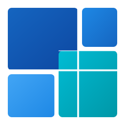
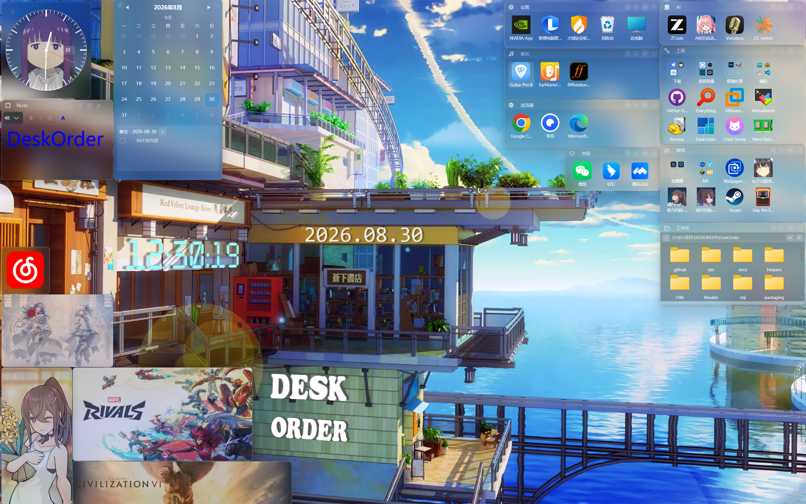
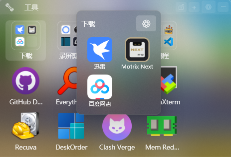
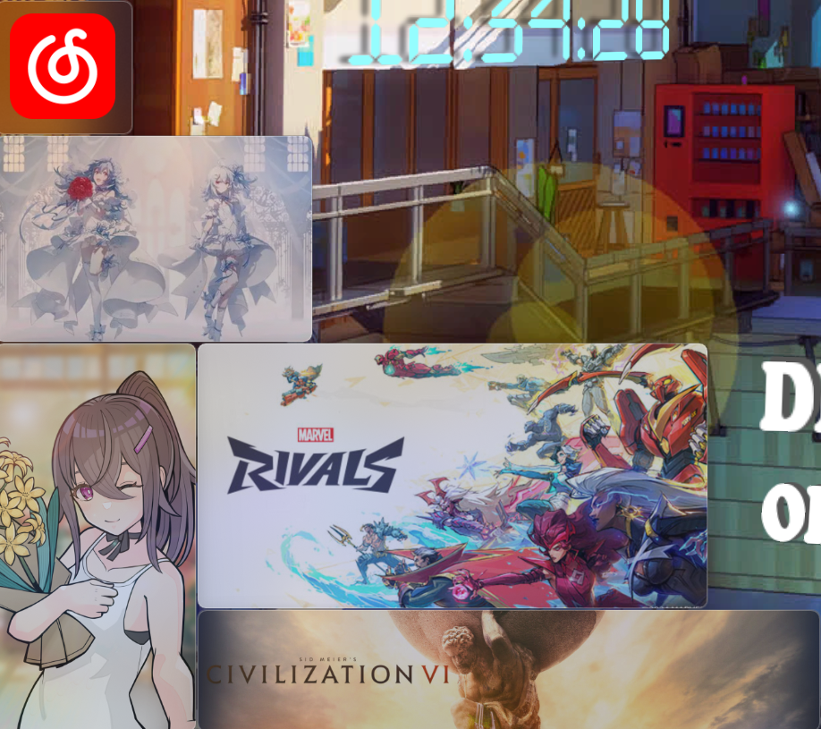
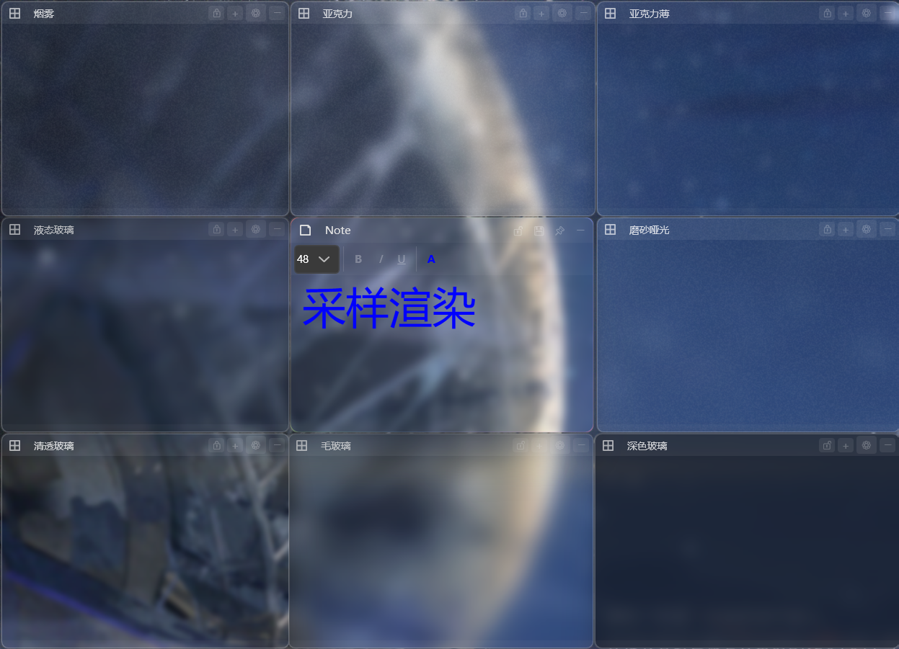
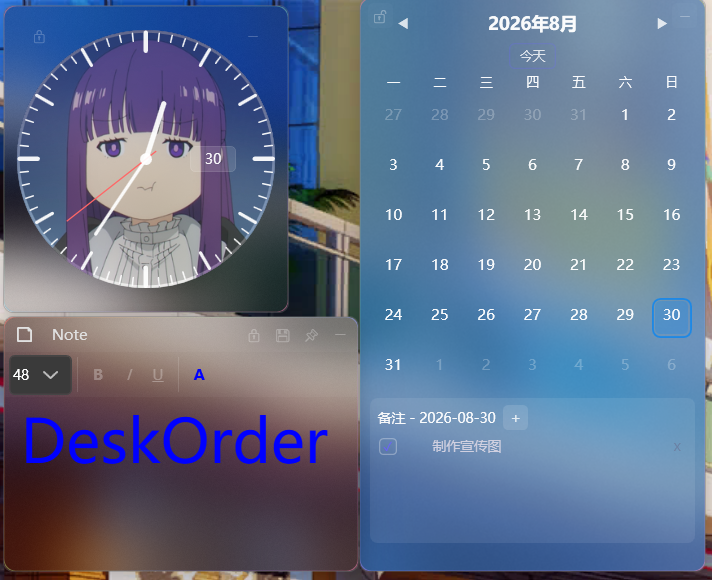
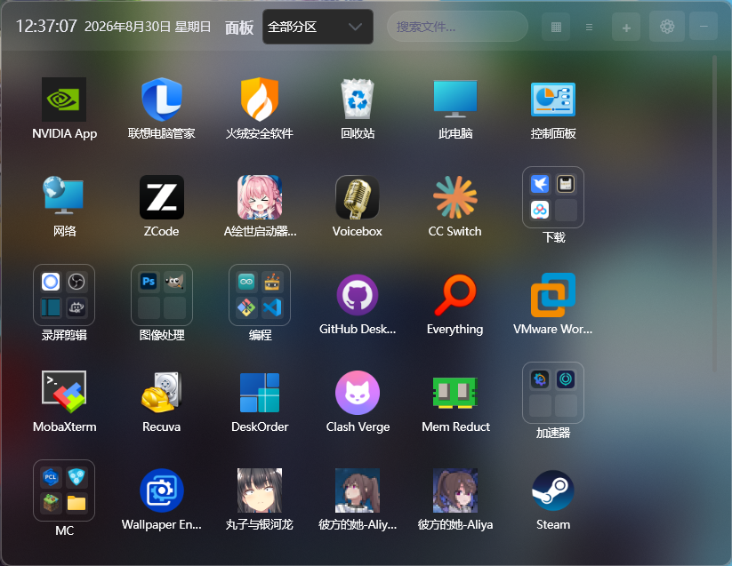
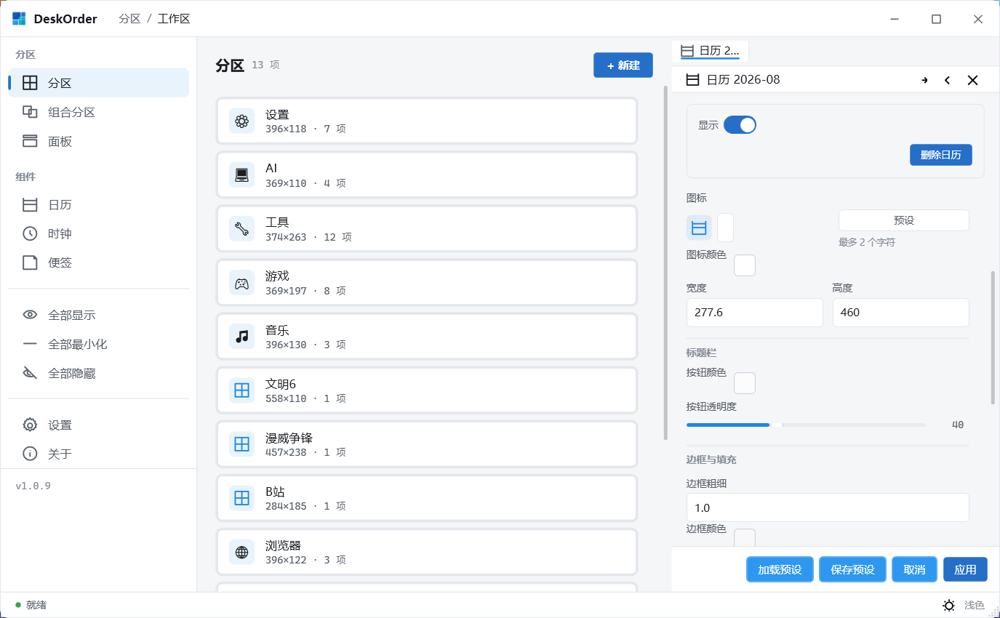
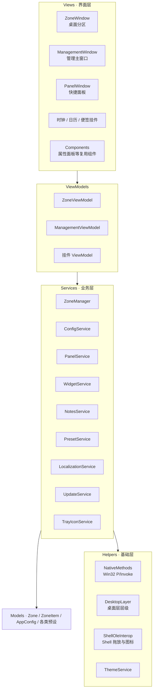

**简体中文** | [English](README.en.md)

<div align="center">
  

  <h1>DeskOrder 秩序桌面</h1>

  <p><strong>桌面分类管理和磁贴美化，一个软件全实现</strong></p>

  <p>
    <a href="https://github.com/Three-Freezen/DeskOrder/releases/latest"></a>
    <a href="https://github.com/Three-Freezen/DeskOrder/releases"></a>
    <a href="LICENSE"></a>
    
    
    <a href="https://three-freezen.github.io/DeskOrder/"></a>
  </p>
</div>



---

## 简介

桌面图标太乱，想分类收纳；又想让桌面好看一点。这两件事通常要装两个工具。DeskOrder 把它们做在了一起：用分区把图标收整齐，用磁贴、液态玻璃和挂件把桌面排成想要的样子。

- 分类管理和磁贴美化，二合一
- 样式全都能改，改好存成预设卡，别的分区一键套用
- 图标只记录文件原路径，文件不搬家，删图标不动文件

## 效果预览













## 下载与安装

系统要求：Windows 10 1809（build 17763）及以上，64 位。软件自带运行时，不需要另外安装 .NET。

提供两种包：

- **安装版** DeskOrder-win-Setup.exe：向导安装，之后可在设置里一键升级
- **便携版** DeskOrder-win-Portable.zip：解压即用

命令行下载（PowerShell，直接拉取最新版）：

```powershell
# 安装版
irm https://github.com/Three-Freezen/DeskOrder/releases/latest/download/DeskOrder-win-Setup.exe -OutFile DeskOrder-win-Setup.exe

# 或便携版
irm https://github.com/Three-Freezen/DeskOrder/releases/latest/download/DeskOrder-win-Portable.zip -OutFile DeskOrder-win-Portable.zip
```

也可以到 [Releases 页面](https://github.com/Three-Freezen/DeskOrder/releases)手动下载。

升级：打开「设置 → 检查更新」，下载完成后自动重启安装，配置不会丢。

## 软件功能

### 桌面分区（分类管理）

- 任意数量的透明悬浮分区，四角缩放、标题栏拖动、多显示器支持
- 文件、文件夹拖进来就归类，也支持点击导入；回收站、控制面板这类系统级项目，通过右键「导入系统项目」窗口选择导入
- 右键菜单：打开、打开位置、重命名、删除
- 图标网格或自由排列，网格大小就是图标大小；支持吸附网格、尺寸变化自动重排
- **文件直连原路径**：图标只是原文件的引用，不复制、不移动；删掉图标，文件还在原处
- 文件夹映射：把电脑里的某个文件夹或磁盘映射进分区展示，在分区里做的操作会同步到原文件夹
- 自动整理：监听指定文件夹，按扩展名或文件名关键字，新文件自动归入分区；也可以选定文件夹和筛选条件，一键扫描把已有文件整理进分区
- 三态开关：显示 / 最小化 / 彻底隐藏；双击桌面可以一键显示或隐藏全部分区（可关闭）

### 磁贴与美化

- 磁贴模式：分区变成一块大磁贴（标题栏隐藏），可再开启自定义图标——整个分区只放一个图标，双击即打开对应文件
- 液态玻璃：八种材质预设（亚克力、烟雾、毛玻璃、液态玻璃、深色玻璃等），模糊量、着色透明度、光度可调，调好的配方存进预设卡
- 背景图：自定义图片，透明度、裁剪、偏移、缩放都能调
- **自定义预设卡**：把调好的整套样式存成卡片，其他分区、面板、挂件直接套用，不用一项项重设

### 桌面挂件

- 时钟：指针 / 数字两种模式，12 / 24 小时制，秒针颜色也能换
- 日历：待办提醒，到点通过托盘通知
- 便签：每张便签可绑定全局热键，随时唤起

### 播放器

桌面上的「正在播放」：律动条和唱片机两种形态，创建时选定，之后不再改。

- **两种形态**：律动条是一排跳动的频谱；唱片机是黑胶盘加旋转的专辑封面。两种都能开磁贴模式（只留内容，不画背景和边框）
- **真实频谱**：默认按系统混音的真实频谱跳动（WASAPI 环回 + 手写 FFT，属性面板可切回模拟律动）；安静时条子落回底部，暂停即静
- **曲目与封面**：自动读取系统正在播放的曲名、歌手、专辑和封面，可直接上一曲 / 暂停 / 下一曲；换歌时封面跟着换
- **封面取色**：从专辑封面提取主色，律动条颜色、分割线和唱片机中心标签跟着专辑变色；封面取不到可用主色时退回手设颜色
- **跟随指定应用**：同时有多个播放器在放时，可以让某个播放器只跟某个应用（另一个跟别的），播放控制也只发给它
- **两套预设卡**：律动条和唱片机各自一套预设，分开存放、互不混用；调好的样式存成卡片，新建时一键套用
- **认不出也能动**：没有接入系统媒体会话的播放器（如网易云音乐）靠音频会话电平 + 窗口标题 + 它自己的播放缓存兜底识别，控制走系统媒体键；实在认不出是谁在出声时，只让条子 / 唱盘跟着动，不显示曲目内容

### 快捷栏

桌面层上的一条胶囊，把常用应用排成一行 —— 像系统任务栏，但外观和动效完全跟着分区那套走。

- **单行排列**：图标大小、间距、内边距由一条公式算出来，增删图标自动伸缩；可开「最小化成 36×36 恢复按钮」和「悬停展开」，三态开关是显示 / 最小化 / 完全隐藏
- **悬停放大**：1.0–2.0 倍，放大原点是格子的底边中点，相邻图标自动让位；窗口上方留出放大余量、下方留出倒影带，放大时不会被窗口边界切掉
- **图标倒影**：每个图标下方可挂一份垂直翻转、压扁、向下渐隐的镜像，透明度可调
- **开始按钮**：可选，带一条分隔线，点它开开始菜单
- **外观**：磁贴、液态玻璃、背景图、圆角 / 尖角、边框、预设卡与分区**同一套**；右键菜单、拖拽排序、单击启动也全部沿用分区的行为

### 快捷面板

全局热键呼出，全部分区卡片收纳在一处；内置文件搜索、新建文档和文件夹、导入系统项目。弹出位置和动效可调。

### 合并组

多个分区组成一组统一管理，样式一起换。

### 插件市场

侧栏「插件」是独立的一栏，插件由社区制作，官方只维护索引、不做代码审核。

- **六类插件**：桌面组件（`widget`）、分区插件（`zonebar`）、语言包、外观包、工具插件（v1.1 起）、数据源（v1.2 起）——六类均已开放
- **一个包多类型**：一个代码插件可以用 `kinds` 同时提供多种能力（如「桌面组件 + 工具插件」，最多 4 种，声明式包仍单类型）；市场卡片、详情与类型筛选按全部能力展示，更新到新增能力的版本时会单独提示。示例见社区仓库 `samples/multikind-demo`
- **桌面组件**：插件画任意 WPF 内容，窗口、拖动、吸附、锁定、三态开关、每实例设置都由宿主负责；卸载插件后组件显示占位，重装即恢复
- **新建组件**：装好并启用 `widget` 类插件后，在侧栏「组件 → 插件组件」或插件市场「已安装」该插件行点「新建组件」，即可创建桌面组件
- **分区插件**：给分区延伸能力——坞窗口、四边吸附、自动隐藏、展开/收起、拖入吸收与分区安全都由宿主负责，插件只画内容；当前实现的形态是「贴边分区坞」，把最小化的分区恢复按钮收进贴边坞，点击/悬停展开
- **工具插件**：往托盘菜单、面板与分区右键的「插件工具」子菜单里加命令；插件只注册命令，全局热键由用户在侧栏「插件 → 插件工具」页给命令分配或清除、重启后保留；命令执行失败只弹托盘提示，不会崩宿主
- **数据源**：插件向宿主提供数据，v1.2 起首个契约是「媒体源」——媒体播放器（律动条/唱片机）属性面板 →「播放与显示」→「数据源」里可选「系统媒体会话」或已启用插件注册的源（显示「源名 · 插件名」）；选中后用插件数据渲染标题、艺术家、专辑与封面，与「跟随的应用」互斥，插件源消失或没有内容时自动回退系统会话；当前是只读数据源，播放/暂停/上一首/下一首仍作用于系统媒体会话
- **语言包**：社区可以新增界面语言（日语、繁体中文…）或覆盖中英文；允许只翻一部分，缺的词条按 `base → en → zh` 回退；装完出现在 `设置 → 语言`，切换即时生效，卸载当前语言会回退中文并提示。v1.2 起语言包还支持 **RTL**（阿拉伯语、希伯来语等：管理窗口、属性面板与对话框镜像，桌面层窗口保持原方向）与**复数规则**（payload 可选 `_plural` 段，按语言给出 zero/one/two/few/many/other 形态）。官方已上架**日语全量包**（当前覆盖 967 条词条；宿主 v1.2.1 新增词条尚未补译，缺的词条按英文回退）
- **外观包**：社区提供材质（背板/模糊/颗粒/着色）与分区/面板/便签/时钟等预设；安装后材质出现在「外观 → 材质」下拉框、预设出现在「加载预设」，停用/卸载即撤销，不会自动改现有对象（材质与内置材质一样需要开启「壁纸采样」渲染方案）
- **一句话看懂类型**：桌面组件/分区插件/工具/数据源会执行代码，需要重启；外观包/语言包是纯数据，不执行代码
- **官方标记**：只有作者 GitHub 账号与仓库都属于 `Three-Freezen` 才显示「官方」；本地导入的包永远不算官方
- **签名**：官方代码插件必须带 minisign 签名（公钥内置在应用里），签名对不上直接拒装；声明式包可选签名。签名只证明「是谁发的、有没有被改」，不代表安全审核
- **更新**：更新前展示 changelog 与**权限变化**；新增联网权限要重新勾选同意才会下载；包内声明的权限不得超出市场条目（否则拒装）；`minAppVersion` 高于当前版本时不给下载；代码类更新后提示重启
- **禁用名单**：registry 顶层 `blocked[]` 命中的版本会被强制停用、开关置灰，只能卸载或等修复版；装了插件时启动会后台刷新一次索引；下架的插件保留文件但不再更新
- **举报**：详情页「举报」直接打开 GitHub issue 表单（预填插件与版本）
- **本地导入**：`插件市场 → 从本地导入…` 选 `.dopkg`，安装前展示类型、作者、版本、包大小、SHA-256 与权限
- **从 GitHub 安装**：`插件市场 → 从 GitHub 安装…` 粘贴作者仓库地址（`owner/repo` 或仓库/Release URL），即可装该仓库最新 Release 的 `.dopkg`；不走社区索引、也不做代码审核，仍需自行判断来源
- **详情与更新**：详情页可翻看作者上传的全部预览图（最多 8 张）；市场里有新版本的插件自动置顶（先于官方排序），已安装列表的行内也能直接「更新」到新版本
- **兼容性提前判定**：条目的 `apiVersion` 高于宿主支持的插件 API、或 `minAppVersion` 高于当前版本时，卡片与详情页直接置灰并写明原因，不会等下载完才失败；已安装的旧版本仍可正常启停
- **设置**：`设置 → 插件` 除总开关外，还可关闭「启动时加载插件」（排查崩溃用，语言/外观包不受影响）、填写索引镜像地址（国内可换 jsDelivr 镜像），并查看/清理 50 MB 上限的图片缓存；市场搜索支持按作者、标签与插件类型查找，空态提供「重试 / 本地导入」
- **安装量与权限**：卡片显示社区统计的安装次数（由社区仓库的定时 CI 自动回写 `registry.json` 的 `downloads`，作者无需手填）；代码类插件的卡片还会显示申请的权限数量，悬停可看明细
- **插件组件外观**：插件组件的窗口外观（宽高、填充、边框、圆角、材质、磁贴模式、锁定）在宿主属性面板里调，和内置便签/时钟同一套面板；插件只负责内容
- **安全兜底**：zip 路径穿越、哈希不符、引用宿主程序集、超大包、语言包占位符或 `_plural` 写错、外观包材质越界/预设类型不符全部拒装；连续两次启动失败自动禁用；`--safe-mode` 本次跳过代码插件（声明式包仍生效）
- **插件开发**：`--plugin-dev=<目录>` 把源码输出目录直接挂上（仅 Debug 构建），改名重编即可，不落配置

> ⚠ 插件全部由社区制作，官方不做任何审核。安装即代表你把当前用户权限交给它，请自行判断风险。

### 系统集成

- 分区驻留桌面层：在壁纸之上、普通应用窗口之下，不挡应用
- 系统托盘、开机自启
- 中英双语，另有社区语言包（官方日语全量包已在插件市场上架；v1.2 起语言包支持 RTL 与复数规则），切换即时生效
- 浅色 / 深色主题
- 应用内更新

## 软件特色

### 分类管理和磁贴美化，二合一

分区负责把东西收整齐，磁贴和挂件负责好看。不用一边装整理工具、一边装美化工具，也不用来回同步两套配置。

### 自定义程度高，还不用反复调

从边框、填充、标题栏到背景、材质、动效，每个部分都能改：

| 维度 | 可调项 |
|---|---|
| 边框 | 颜色、透明度、粗细 |
| 填充 | 内部填充颜色、透明度，标题栏可单独设置 |
| 标题栏 | 颜色、透明度、名称颜色 |
| 材质 | 液态玻璃（模糊量、着色、光度） |
| 背景 | 图片、透明度、裁剪、偏移、缩放 |
| 图标 | Emoji 图标、图标颜色、磁贴自定义图标 |
| 内容 | 主体内容颜色、按钮颜色、各元素透明度 |
| 布局 | 网格大小、吸附网格、自由排列、自动重排 |
| 形状 | 圆角 / 尖角、任意尺寸 |
| 动效 | 动效设置、悬停展开动画 |
| 预设 | 自定义预设卡、九色统一预设、内置取色器 |

调满意的整套样式存成预设卡，换个分区一键套上。第一次调麻烦一点，之后不用重来。

### 丰富的液态玻璃

玻璃背板有两种渲染方案，设置里一键切换：

**DWM 方案（默认）**：把模糊交给 Windows 系统合成器（DWM）。窗口声明玻璃效果后，DWM 在桌面合成时对窗口背后的实际画面做实时模糊——糊的就是背后正在显示的内容。所以它天然兼容一切动态背景：视频壁纸、Wallpaper Engine 这类动态壁纸软件，画面动，玻璃跟着动，全程实时、不占应用自己的渲染开销。代价是模糊强度由系统固定（Win11 上实测拖模糊半径没有区别），材质预设不参与渲染，只有颜色、不透明度、亮度照常生效。

**壁纸采样渲染（新方案）**：应用自己画背板。先把当前壁纸采样成一张 1:1 物理分辨率的位图，按设定的模糊半径做高斯模糊，再按每个窗口在屏幕上的位置裁出对应区域铺在底层，上面叠着色层与颗粒层——模糊半径是真实像素，八种材质预设（背板类型、颗粒强度、着色参数）全部生效。也能自动适配 Wallpaper Engine / Lively / 火萤等动态壁纸软件：图片类直接读原文件，场景类抓取当前画面（抓屏瞬间玻璃窗口会短暂让开，不会把自己采进去）；多显示器各自铺各自的壁纸。代价是采样拿到的是静态画面：动态壁纸动起来，背板不会跟着动（这点只有 DWM 方案做得到），换了壁纸或画面变了，到设置里点一下「重新采样」即可刷新。

简单说：要跟着动态壁纸一起动、追求零开销，用 DWM 方案；要真实可调的模糊半径和完整材质手感，用壁纸采样渲染。

### 图标直连原文件，删了也不怕

分区里的图标只是文件路径的引用：文件始终在原位，DeskOrder 不复制、不移动、不改名；删图标只是去掉引用，原文件好好的。配合文件夹映射和自动整理，所有整理动作都不碰文件本体。

### 其他

- 自包含发布，不依赖系统里装没装 .NET
- 内存和渲染做过专项优化
- 配置全部存本地，不上传数据
- Apache-2.0 开源

## 技术架构

| 项目 | 说明 |
|---|---|
| 语言 / 运行时 | C#，.NET 10（自包含发布） |
| 界面框架 | WPF |
| 系统集成 | Win32 P/Invoke |
| 配置存储 | JSON（%APPDATA%\DesktopZones） |
| 打包 / 发布 | Inno Setup + GitHub Actions |



几个关键实现：

- 桌面层层级策略：分区和挂件固定在壁纸之上、应用窗口之下，置顶、拖拽结束后自动回落
- Shell 集成：图标提取、OLE 拖放、快捷方式解析
- 配置读写：内存缓存 + 原子写入，避免写坏配置文件
- 本地化：i18n JSON 资源，界面语言切换即时生效

## 从源码构建

```bash
git clone https://github.com/Three-Freezen/DeskOrder.git
cd DeskOrder
dotnet build

# 本地运行
dotnet run
```

发布单目录：

```bash
dotnet publish DesktopZones.csproj -c Release -r win-x64 --self-contained
```

打包安装器和便携版用 `tools/pack.ps1`（需要先装 [Inno Setup 6](https://jrsoftware.org/isinfo.php)）。正式发布由 GitHub Actions 自动完成，产物上传到 Releases。

发版用 `tools/release.ps1`：推送代码 → 打 `v<版本号>` 标签 → 等 Actions 构建完 → 用 `releases\notes-<版本号>.md`（中英双语）覆盖 Release 正文。先加 `-DryRun` 可以只做检查不推送。

## 未来展望

- 播放器的更多主题与「只跟音乐软件」的按应用采集（P2）
- 性能优化

更新记录见 [Releases](https://github.com/Three-Freezen/DeskOrder/releases)。

## 许可证

[Apache License 2.0](LICENSE) · Three-Freeze

自 v1.0.19 起采用 Apache-2.0；此前各版本同此许可。
